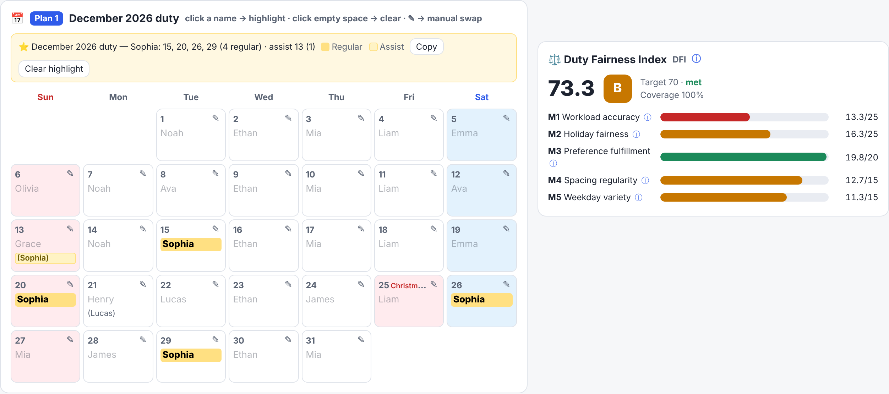

# Duty Roster Generator (Duty Fairness Index)

**English** · [한국어](README.ko.md)

A free, single-file web app that builds a month of on-call duty rosters for doctors in seconds and scores each plan with a **Duty Fairness Index (DFI)**.

**Try it now:** https://onlymarch.github.io/dutywebapp/

[](https://onlymarch.github.io/dutywebapp/assets/promo-20s.mp4)

▶ [Watch the 20-second intro in full HD with sound (MP4, 1080p)](https://onlymarch.github.io/dutywebapp/assets/promo-20s.mp4)

- No install, no sign-up, no server — **your roster never leaves your browser**
- Preferred / available / unavailable dates and weekdays, rest days after duty, monthly limits, weights
- Junior staff can be paired with an assistant automatically
- Interface in English, 한국어, 日本語, 中文, Français and Español



Current version: **v1.14.3** (2026-11-23)

> This is a scheduling aid. Please have the person responsible check the final roster before publishing it.

## How to use

1. **Settings** — Pick the target month. Korean public holidays are filled in automatically; for other countries, type your holidays or click them on the mini calendar. Use the sliders to set rest days after a duty (0–5) and the target DFI (50–100, in steps of 5). The number of attempts is automatic (see *Attempts* below).
2. **Staff roster** — Enter name, level, weight, monthly max, preferred dates, preferred weekdays, available dates, unavailable dates and unavailable weekdays. Write dates like `3, 15, 20~22`; ranges accept both `~` and `-`. `-5` means days 1–5 and `25-` means the 25th to the end of the month. If a range ends past the last day (e.g. `15-31` in February), it is cut at the month end. You can also pick dates on a calendar with the 📅 button.
3. **Generate** — A pre-check flags conflicting input before you start. When it finishes, you see how many attempts were made, how long it took, when the best score last improved, and a chart of the best DFI over attempts.
4. **Results** — Compare the top 3 plans by DFI and choose one. Click a name (or a row in the stats table) to highlight that person's days; use ✎ to swap someone manually (with rule warnings and undo).
5. **Print & save** — One-page A4 print with an approval box, a printable HTML file, CSV, or JSON backup.

## Languages

Pick a language from the dropdown at the top of the page: **English · 한국어 · 日本語 · 中文 (简体) · Français · Español**.

- The whole interface switches instantly, including tooltips, dialogs, the print sheet and CSV.
- On first visit the app follows your browser's language (English if it is not one of the six). After that, your choice is remembered in this browser.
- Names and other text you type are never translated. The built-in holiday data is for Korea; only the holiday names are translated.

## Assignment rules

| Item | Description |
|---|---|
| Priority | Preferred dates (0) → preferred weekdays (1) → available dates (2) → any other day (3) |
| Not assigned | Unavailable dates, unavailable weekdays, or when the monthly max is reached |
| Rest days after duty | No duty for *n* days after a duty, set separately for weekday and holiday duties. With 1, someone on duty on the 3rd is available again from the 5th. |
| Weight | Share of the workload (default 1.0). Expected duties = assigned days × own weight ÷ sum of weights. |
| Preferred-date quota | If someone's remaining limit is no more than their remaining preferred dates, they are held back on other days. |
| Level | 1 Exempt (rest days don't apply) · 2 Senior · 3 Regular (can assist) · 4 Junior (needs a level-3 assistant) |

Within the same priority, the person with the fewest duties so far in that category (holiday / Thu–Fri / Mon–Wed) and on that weekday goes first. Ties are broken at random, so every attempt gives a different plan.

## Attempts

You don't set the number of attempts; it depends on the target DFI.

- At least **500** attempts are made. After that, the run stops once **5 different plans** reach the target DFI. A low target finishes near 500 attempts.
- Otherwise it keeps going up to **20,000** attempts. The higher the target, the longer the search.
- If the browser is slow, the run stops after **5 seconds** with the best plans found so far (this takes precedence over the 500 minimum).

## Duty Fairness Index (DFI)

Scored out of 100. If some days are left unassigned, the total is multiplied by the coverage rate.

| Metric | Points | Calculation |
|---|---|---|
| M1 Workload accuracy | 25 | RMSE between expected and actual duties. 25 − RMSE × 8 |
| M2 Holiday fairness | 25 | SD of holiday duties per person. 25 − SD × 12 |
| M3 Preference fulfillment | 20 | Preferred dates 8 + preferred weekdays 4 + available dates 4 + avoiding unavailable dates 4 |
| M4 Spacing regularity | 15 | Mean SD of gaps between duties (people with 3+ duties). 15 − SD × 3 |
| M5 Weekday variety | 15 | Mean SD of each person's weekday distribution. 15 − SD × 5 |

Grades: S ≥ 90, A ≥ 80, B ≥ 70, C < 70. Hover (or tap) the ⓘ marks and metric bars to see how each score is calculated and how to improve it.

## Your data

There is no server. Settings and rosters are stored only in your browser (cookies and localStorage) and are never sent anywhere.

- To move to another device or browser, use **JSON backup** and **JSON restore**.
- Clearing browser data deletes what you saved. Keep important rosters as JSON files.

## Run locally

Download `index.html` and open it in a browser. Nothing to install.

## Files

| File | Contents |
|---|---|
| `index.html` | The whole app (UI, scheduling engine, DFI, storage, printing, translations) |
| `tests/ui-qa.js` | UI test suite (23 categories, 135 checks, including all languages) |
| `README.ko.md` | Korean README |
| `assets/` | Screenshots, link-preview image, the 20-second promo video and its GIF preview |
| `promo/` | Source for the promo video (screen capture, motion graphics, renderer) |
| `.nojekyll` | Tells GitHub Pages to serve files as they are |

## Tests

Run with Playwright (Chromium):

```bash
npm install playwright
```

```bash
npx playwright install chromium
```

```bash
node tests/ui-qa.js
```

The last line should read `총 135건 · 통과 135 · 실패 0` ("135 total · 135 passed · 0 failed"). Tests have been run on Chromium only, not on Safari or iOS.

## Feedback

Bug reports and ideas — especially about duty rules in your country or hospital — are welcome as [GitHub issues](https://github.com/onlymarch/dutywebapp/issues).

## License

MIT
